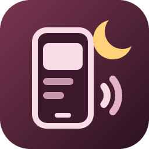

# Nightping

> **Status:** in development. Not yet on the Marketplace or Open VSX.

Phone push notifications from VS Code, through **your own [ntfy](https://ntfy.sh) server or topic**. Start a long build, a test run, a notebook cell or an AI agent, walk away, and get a ping when it finishes, fails or needs your approval.

## What it notifies you about

- **Tasks**: a task finished, with its result and how long it ran.
- **Terminal commands**: a command finished, with its exit code. This needs [shell integration](https://code.visualstudio.com/docs/terminal/shell-integration), which bash, zsh, fish, Git Bash and PowerShell 7 have; Windows PowerShell 5.1 has it only when scripts are allowed to run. The panel tells you when none of your open terminals has it.
- **Notebook cells**: a cell finished running.
- **Debug sessions**: a debug session ended.
- **Claude Code**: a turn finished, Claude asks you something, or it waits for your approval; in a terminal or in VS Code's Claude Code panel. See [Claude Code](#claude-code) below.

- **Your own messages**: typed in the panel or with **Nightping: Send Message…**, or sent by a key binding or another extension. See [Send your own message](#send-your-own-message) below.

Coming next: other AI agents (Codex, Copilot, Gemini CLI, Cursor and others through their hooks).

A notification reads at a glance: the title says what finished, the message how it ended and how long it took, for example **❌ Task** / *Failed (exit 1) · 4m 12s*. Failures, questions and approval requests arrive at high priority.

## Claude Code

**Connect it with one click.** In the Nightping panel, click **Connect Claude Code** (or run **Nightping: Connect Claude Code…**). After you confirm, Nightping adds three HTTP hooks to Claude Code's user settings, `~/.claude/settings.json` (or the folder an absolute `CLAUDE_CONFIG_DIR` names): when you send a prompt, when Claude finishes, and when it needs you. It saves a copy of the file as `settings.json.nightping.bak` first and leaves your other settings and hooks as they are. **Disconnect** removes only Nightping's hooks. Claude Code picks the change up without a restart. When you set up Nightping with **Nightping: Set Up…** and Claude Code is on the computer, the test notification offers to connect it.

**Or add the hooks yourself.** **Copy Settings** (or **Nightping: Copy Claude Code Hook Settings**) puts them on the clipboard; add them under `"hooks"` in the settings file, or paste them to Claude Code and ask it to add them to your user settings:

```json
{
  "hooks": {
    "UserPromptSubmit": [{ "hooks": [{ "type": "http", "url": "http://127.0.0.1:47391/nightping/claude-code", "timeout": 5 }] }],
    "Stop": [{ "hooks": [{ "type": "http", "url": "http://127.0.0.1:47391/nightping/claude-code", "timeout": 5 }] }],
    "Notification": [{ "hooks": [{ "type": "http", "url": "http://127.0.0.1:47391/nightping/claude-code", "timeout": 5 }] }]
  }
}
```

How it works:

- The hooks post to Nightping on this computer only, at `127.0.0.1` on port 47391 (`nightping.port`; after a change, reconnect). Your ntfy server, topic and token never go into Claude Code's settings. Nightping answers at once with an empty reply, so Claude Code never waits for it and never changes what it does.
- One VS Code window receives the events; when it closes, another one takes over within seconds. While VS Code is closed, the hooks reach nobody and Claude Code goes on as usual.
- The same rules as for everything else apply: quiet while you are using the VS Code window, the minimum duration for finished turns (questions and approval requests notify at once), pause, and the content level. At the **details** level a finished turn adds the first sentence of Claude's reply, and an approval request what Claude asks permission for; this goes to your server.
- A turn in which a subagent is still running is not finished yet: Claude goes on when the subagent is done, and that end notifies.
- If you already get Claude Code notifications another way (your own hook, for example), turn that off, or they arrive twice.

## When it notifies

By default Nightping stays quiet while you are using the VS Code window where the run finished (it is focused and you used it in the last few seconds), and about runs that succeed in under 30 seconds. Failures notify at any duration.

All of this is in the **When to notify** card of the Nightping panel, and changes apply right away:

- each kind of event on or off (`nightping.notifyOn.*`),
- the minimum duration (`nightping.minimumDuration`, in seconds; `0` notifies about every run),
- **Only when I am away** (`nightping.onlyWhenAway`),
- the content (`nightping.content`): the result and duration only (default), also the workspace name, or also the task name, command line or file name. A preview shows what your phone will get.

**Pause** notifications for 30 minutes, an hour, four hours or until you resume: with **Pause…** at the top of the panel, from the status bar item's hover, or with **Nightping: Pause Notifications…**. The pause holds in every VS Code window on this computer, the status bar says **Paused**, and **Resume** ends it. Test notifications still go out. For a key binding, pass the minutes: `{ "key": "…", "command": "nightping.pause", "args": 60 }`.

Hovering over the status bar item also shows the last notification, or why it was not sent.

## Send your own message

Type a message in the panel's **Send a message** card, or run **Nightping: Send Message…**, and it goes to your phone at once, even while notifications are paused.

Key bindings and other extensions pass the message to the `nightping.send` command, as text or as an object:

```jsonc
// keybindings.json
{
  "key": "ctrl+alt+n",
  "command": "nightping.send",
  "args": { "title": "Lunch", "message": "Back in five minutes", "priority": 3, "tags": ["sandwich"] }
}
```

```ts
// In another extension
const result = await vscode.commands.executeCommand('nightping.send', {
  title: 'Deploy',
  message: 'Staging is up',
});
```

- `message` (required): up to 1000 characters; longer text is cut.
- `title`: one line, up to 100 characters; `VS Code` when left out.
- `priority`: 1 (min) to 5 (max), as in ntfy; 3 when left out.
- `tags`: up to 5 [ntfy tags](https://docs.ntfy.sh/emojis/); emoji short codes such as `warning` or `tada` show as emojis.

The command returns `{ "sent": true }`, or `{ "sent": false, "reason": … }` with `"paused"`, `"not-set-up"` or `"failed"` (with an `error` that says why). While notifications are paused, passed messages are held back; the **When to notify** conditions do not apply to them. Anything else it cannot send, such as a priority of 9, fails with an error that names the problem.

## Your server, your settings

Nightping ships with **no server, no topic and no account**. Nothing is sent until you enter your own:

- the ntfy server URL (for example `https://ntfy.sh` or your self-hosted `https://ntfy.example.com`),
- a topic,
- an optional access token, stored in VS Code's secret storage.

Requests go only to the server you entered. There is no telemetry and no other network traffic. By default a notification contains only the kind of event, the result and the duration; the workspace name, task names, command lines and file names are added only if you choose them under **Content**.

Click the Nightping item in the status bar (or run **Nightping: Open**) to open the Nightping panel. Enter the server, a topic and an optional token, save, and send a test notification. If it does not arrive, the panel says why: a missing or refused token, a redirect, an unreachable server. Below the form, **Recent notifications** lists what Nightping sent, or tried to send and why it could not; the list stays on this computer.

Prefer the keyboard? **Nightping: Set Up…** asks for the same three things in the Command Palette, and **Send Test Notification**, **Set Access Token…** and **Clear Access Token** are there too.

The server and topic are user settings, so Settings Sync takes them to your other computers. The token stays in the secret storage of each computer; set it again there in the panel or with **Nightping: Set Access Token…**.

The README will include a step-by-step guide for both ntfy.sh and a self-hosted server before the first release.

## License

[MIT](LICENSE) © MBK Dev Studio
